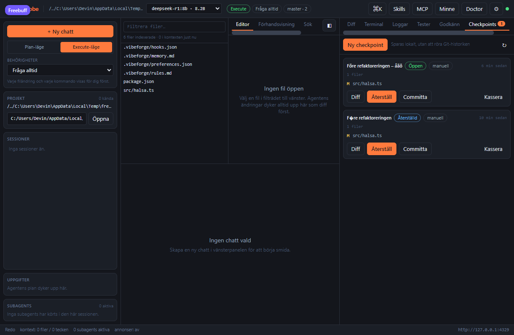

# Checkpoints och ångra

Varje gång agenten är på väg att skriva, ändra eller ta bort en fil sparar Freevobe filens tidigare
innehåll i en **checkpoint** – innan skrivningen sker. Checkpointen lever helt vid sidan av Git: du
kan backa till den utan att röra historiken, och committa den till Git först när du är nöjd.

## Vad som sparas

En checkpoint skapas per agentkörning och innehåller bara de filer som faktiskt ändrades:

| Fält         | Innehåll                                                                          |
| ------------ | --------------------------------------------------------------------------------- |
| `label`      | Promptens första rad, eller namnet du ger en manuell checkpoint                   |
| `reason`     | `agent-run` eller `manual`                                                        |
| `files`      | Sökväg, ändringstyp (`create`/`update`/`delete`), tillagda och borttagna rader    |
| `testStatus` | `unknown`, `passed` eller `failed` – från den testkörning som gjordes i körningen |
| `createdAt`  | Tidpunkten                                                                        |

Själva filinnehållet ligger inte i databasen utan i en snapshotfil:

```
<Freevobe-home>/checkpoints/<projekt-id>/<checkpoint-id>.json
```

Databasen (`checkpoints`-tabellen, migrering 2) har bara det tidslinjen behöver, så listan går
snabbt även med många checkpoints. De 50 senaste sparas per projekt; äldre rensas automatiskt.

En körning som bara läser kod skapar ingen checkpoint, och en fil som ändras flera gånger i samma
körning ger fortfarande bara en rad – med innehållet från **före** den första ändringen.

## Återställ

```bash
# Lista projektets checkpoints (projectId kommer från /api/projects)
curl -s -H "x-freevobe-token: $(cat ~/.freevobe/token)" \
  "http://127.0.0.1:4319/api/projects/<projectId>/checkpoints"

# Skillnaden mellan checkpointen och filerna på disk just nu
curl -s -H "x-freevobe-token: $(cat ~/.freevobe/token)" \
  "http://127.0.0.1:4319/api/checkpoints/<checkpointId>/diff"

# Skriv tillbaka filerna
curl -s -X POST -H "x-freevobe-token: $(cat ~/.freevobe/token)" \
  -H 'content-type: application/json' -d '{}' \
  "http://127.0.0.1:4319/api/checkpoints/<checkpointId>/restore"
```

I appen finns tidslinjen i högerpanelen under **Checkpoints**, och kommandopaletten
(`Ctrl/Cmd+K`) har _Visa checkpoints_, _Spara checkpoint av nuvarande läge_ och _Ångra senaste
agentändringen_.



Varje rad visar status (`Öppen`, `Återställd`, `Committad`, `Kasserad`), om den kom från en
agentkörning eller skapades manuellt, antal filer, teststatus och tid. **Diff** öppnar checkpointens
skillnad mot filerna på disk i Diff-fliken, **Återställ** frågar en gång extra innan något skrivs,
**Committa** skapar en Git-commit av filerna och **Kassera** tar bort snapshotet utan att röra
projektet.

### Konflikter

En agentcheckpoint minns hur filen såg ut **efter** ändringen. Har filen ändrats igen sedan dess
hoppas den över vid en återställning, i stället för att nyare arbete kastas tyst:

```json
{
  "restored": [],
  "deleted": [],
  "skipped": [{ "path": "src/halsa.ts", "reason": "changed-since" }]
}
```

Skicka `{"force": true}` för att skriva över ändå. I appen blir det en varning på checkpointens
kort – _"1 fil har ändrats sedan checkpointen och hoppades över: src/halsa.ts"_ – med knappen
**Tvinga återställning** som kräver ett extra bekräftelsesteg innan filen skrivs över. Samma
sökvägar loggas som en varning i **Loggar**.

En **manuell** checkpoint är däremot ett medvetet "tillbaka hit" och skriver alltid över – visa
diffen först om du är osäker.

## Committa en checkpoint

```bash
curl -s -X POST -H "x-freevobe-token: $(cat ~/.freevobe/token)" \
  -H 'content-type: application/json' \
  -d '{"message": "Checkpoint: hälsningen"}' \
  "http://127.0.0.1:4319/api/checkpoints/<checkpointId>/commit"
```

Committen stagingar filerna i checkpointen och skapar en vanlig Git-commit. Checkpointen blir kvar
med status `committed` och commit-hashen, så tidslinjen visar vad som hör ihop.

## API

| Metod    | Väg                                      | Gör                                      |
| -------- | ---------------------------------------- | ---------------------------------------- |
| `GET`    | `/api/projects/:projectId/checkpoints`   | Listar tidslinjen, nyast först           |
| `POST`   | `/api/projects/:projectId/checkpoints`   | Manuell checkpoint av ändrade filer      |
| `GET`    | `/api/checkpoints/:checkpointId`         | En checkpoint                            |
| `GET`    | `/api/checkpoints/:checkpointId/diff`    | Skillnad mot filerna på disk             |
| `POST`   | `/api/checkpoints/:checkpointId/restore` | Återställ (`force` valfritt)             |
| `POST`   | `/api/checkpoints/:checkpointId/commit`  | Committa filerna till Git                |
| `DELETE` | `/api/checkpoints/:checkpointId`         | Kassera checkpointen (filerna rörs inte) |

En manuell checkpoint kräver att projektet är ett Git-repo och att något faktiskt är ändrat; appens
egen `.freevobe/`-stomme, `.git/` och `node_modules/` hoppas över.

## Flera projekt samtidigt

Databasen är gemensam för alla öppna projekt, så en checkpointrad går att slå upp varifrån som
helst. Filerna läses och skrivs därför alltid i det projekt som **äger** checkpointen
(`projectIdOf`), aldrig i det först öppnade – annars skulle en återställning kunna träffa fel
arbetskopia. `packages/agent-server/src/checkpoints.test.ts` har ett regressionstest med två öppna
projekt som slår fast det.

## Testat i webbläsare

`e2e/checkpoints.ui.spec.ts` har två scenarier i en riktig webbläsare:

1. **Konflikt och återställning** – en agentkörning skapar en fil och en checkpoint, tidslinjen
   visar etikett, fil och status **Öppen**, **Diff** öppnar diffen i Diff-fliken, en ändring
   utanför appen gör att **Återställ** hoppar över filen och visar konfliktvarningen, och
   **Tvinga återställning** kräver ett extra steg innan filen tas bort.
2. **Commit till Git** – ett vanligt Git-repo, en ocommittad ändring och **Ny checkpoint** ger en
   manuell checkpoint; **Committa** med eget meddelande skapar en riktig commit. Testet läser
   `git log -1 --pretty=%s`, `git show --name-only HEAD` och `git status --short` och kräver att
   meddelandet, filen och den städade arbetskopian stämmer, samt att kortet visar **Committad**
   och commit-hashen.

Kör med `npm run test:e2e` (portarna går att flytta med `FREEVOBE_E2E_*`, se README). Committen
sker med projektets lokala `user.name`/`user.email`, så inga globala git-inställningar krävs.

## Begränsningar

- Snapshoten innehåller bara filer som agenten ändrar genom verktygen. Redigerar du själv i editorn
  sparas ingen automatisk checkpoint – gör en manuell först.
- Binära filer sparas som de är, men diffen i appen visar bara text.
- Checkpoints ligger i Freevobes home-katalog, inte i projektet. De följer alltså inte med om du
  flyttar projektet till en annan dator.
