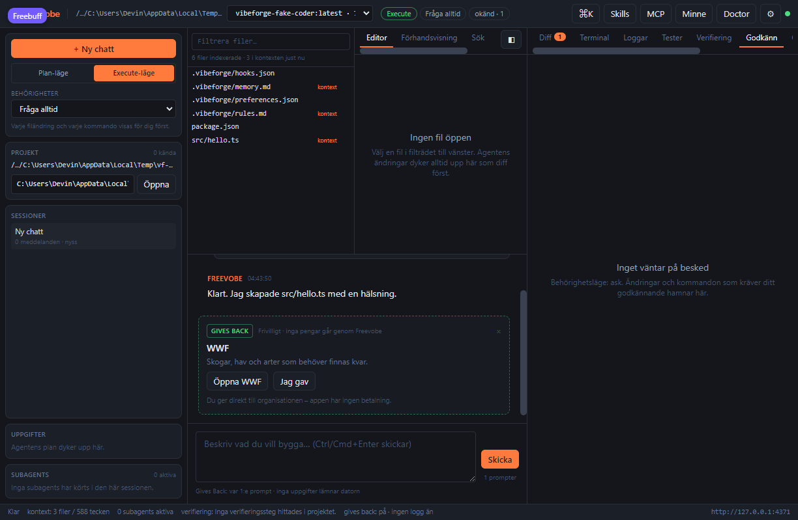
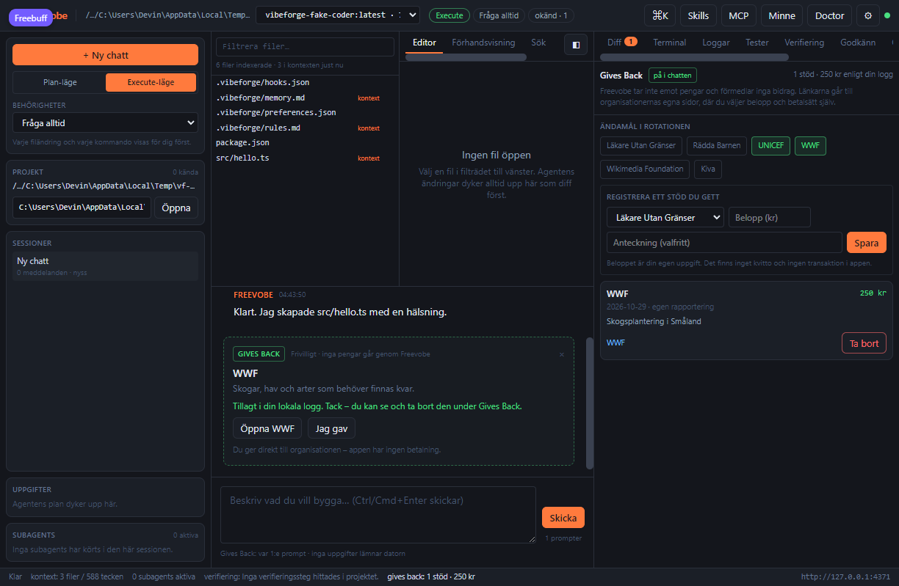
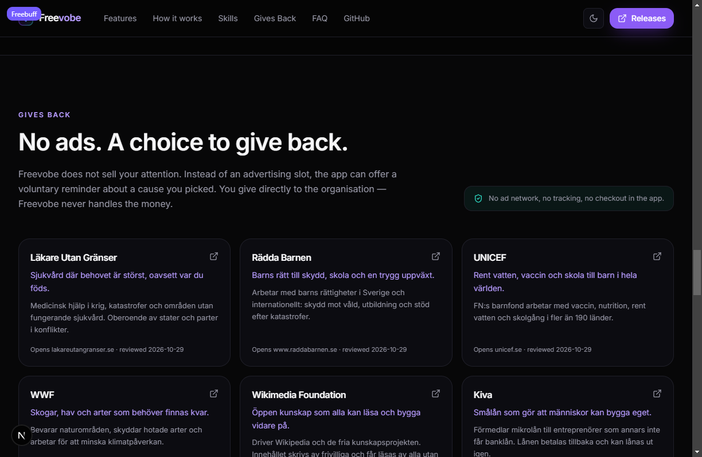

# Freevobe Gives Back

Freevobe säljer inte uppmärksamhet. I stället för en annonsplats kan appen – om du själv slår på
det – visa en liten påminnelse om ett välgörenhetsändamål som du valt. Du ger direkt till
organisationen. Freevobe tar aldrig emot, förmedlar eller räknar pengar.

Dokumentet beskriver exakt vad som är implementerat, vad som medvetet inte är det och hur du
verifierar det själv.

## Principerna

1. **Ingen reklam.** Inga annonsplatser, inga annonsskript, inga annonsnätverk. AdSense-koden är
   borttagen ur både skrivbordsappen och webbplatserna.
2. **Inga pengar genom Freevobe.** Appen har ingen kassa, inget konto, ingen betalningsleverantör
   och ingen integration mot organisationernas system. Varje länk öppnar organisationens egen
   sida i webbläsaren, där du väljer belopp och betalsätt själv.
3. **Av som standard.** Platsen är opt-in. Den slås på i onboarding (steg 4) eller i
   inställningarna och kan slås av när som helst.
4. **Ingen data lämnar datorn.** Platsen får bara ett tal som indata (antal användarprompter). Den
   har ingen åtkomst till prompter, filer, kontext, svar eller projektnamn. Det du själv
   registrerar sparas lokalt och är märkt som egen rapportering.

| Chattflödet                                         | Panelen                                                |
| --------------------------------------------------- | ------------------------------------------------------ |
|  |  |

## Så fungerar det i chatten

`GivesBackCard` renderas mellan chattbubblorna, aldrig inuti ett agentsvar, och bara när:

- `givesBack.enabled` är sant, och
- antalet användarprompter är större än noll, och
- antalet prompter är en jämn multipel av `givesBack.everyNPrompts` (standard 10, minst 1).

Ändamålet roterar deterministiskt genom urvalet: `causeForPrompt(promptIndex, causeIds)` väljer
`promptIndex % antal`. Samma prompt ger alltid samma ändamål, och listan börjar om från början
när den tar slut.

Kortet har tre handlingar:

| Handling     | Vad som händer                                                                              |
| ------------ | ------------------------------------------------------------------------------------------- |
| Öppna <namn> | Öppnar organisationens sida i webbläsaren (`target="_blank"`, `rel="noreferrer noopener"`). |
| Jag gav      | Visar ett litet formulär: belopp i kronor (valfritt) och en anteckning (valfritt).          |
| ×            | Döljer kortet för den här sessionen. Inställningen ändras inte.                             |

Knappen **Jag gav** sparar en rad i din lokala påverkanslogg. Det är en anteckning, inte en
betalning: det finns inget kvitto, ingen transaktion och ingen verifiering. Panelen märker varje
rad med **egen rapportering**.

## Panelen Gives Back

Högerpanelen har fliken **Gives Back** (och statusfältet längst ned öppnar den):

- summan av det du själv uppgett: antal stöd, antal kronor och antal ändamål,
- katalogen med växlingsbara ändamål – vilka som får förekomma i rotationen,
- ett formulär för att registrera ett stöd i efterhand,
- hela loggen, nyast först, med möjlighet att radera varje rad.

Att välja bort alla ändamål är inte möjligt: ett tomt urval betyder hela katalogen. Det förhindrar
att platsen blir tom utan att användaren förstår varför.

## Katalogen

Katalogen är redaktionell och ligger i `packages/protocol/src/gives-back.ts`. Varje post har `id`,
`name`, `tagline`, `description`, `url`, `focus` och `verifiedAt` (dagen en människa senast
granskade beskrivning och länk).

| id                    | Organisation         | Fokus       | Länk                         |
| --------------------- | -------------------- | ----------- | ---------------------------- |
| `lakare-utan-granser` | Läkare Utan Gränser  | health      | https://lakareutangranser.se |
| `radda-barnen`        | Rädda Barnen         | children    | https://www.raddabarnen.se   |
| `unicef`              | UNICEF               | children    | https://unicef.se            |
| `wwf`                 | WWF                  | climate     | https://www.wwf.se           |
| `wikimedia`           | Wikimedia Foundation | knowledge   | https://donate.wikimedia.org |
| `kiva`                | Kiva                 | livelihoods | https://www.kiva.org         |

Länkarna pekar medvetet på organisationernas startsidor i stället för på djuplänkar till en kassa.
En ändrad betalningsväg blir då inte en trasig eller vilseledande länk.

Freevobe har **ingen** överenskommelse, provision eller referral med någon av organisationerna. Det
finns ingen spårningsparameter i länkarna. Att lägga till ett ändamål kräver en mänsklig granskning
av namn, beskrivning och länk, och `verifiedAt` ska uppdateras i samma ändring.

## API

Alla anrop kräver samma token som resten av agenten (`x-freevobe-token`).

```http
GET /api/gives-back?limit=200
```

```json
{
  "ok": true,
  "data": {
    "entries": [
      {
        "id": "give_…",
        "causeId": "wwf",
        "amountSek": 250,
        "note": "Skogsplantering",
        "createdAt": 1793000000000,
        "source": "self-reported"
      }
    ],
    "summary": { "count": 1, "totalSek": 250, "causeCount": 1, "lastAt": 1793000000000 }
  }
}
```

```http
POST /api/gives-back
{ "causeId": "wwf", "amountSek": 250, "note": "Skogsplantering" }

DELETE /api/gives-back/:id
```

`POST` svarar med hela den uppdaterade listan och sammanställningen, så att gränssnittet aldrig
behöver gissa. Fel som avvisas:

- okänt `causeId` (måste finnas i katalogen),
- `amountSek` som inte är ett heltal mellan 0 och 1 000 000,
- anteckning längre än 200 tecken,
- `amountSek` eller `note` av fel typ.

Inställningen sparas som alla andra inställningar:

```http
PATCH /api/settings
{ "givesBack": { "enabled": true, "everyNPrompts": 10, "causeIds": ["wwf"], "consentedAt": 1793000000000 } }
```

## Lagring och migrering

Posterna ligger i `gives_back_entries` (migrering 5 i `packages/agent-core/src/store/db.ts`):

```sql
CREATE TABLE gives_back_entries (
  id TEXT PRIMARY KEY,
  cause_id TEXT NOT NULL,
  amount_sek INTEGER NOT NULL DEFAULT 0,
  note TEXT,
  created_at INTEGER NOT NULL
);
```

Tabellen har ingen koppling till projekt, session eller användare – den är global och lokal, som
resten av databasen i `~/.freevobe/freevobe.db`.

**Gammal annonsplats.** Den som uppgraderar från en version med annonser får sin inställning
migrerad i `SettingsRepository`: `ads.enabled` blir `givesBack.enabled`, och `ads.everyNPrompts`
blir intervallet. Ett gammalt nej förblir ett nej – samtycke till reklam räknas aldrig som samtycke
till något annat. Okända `causeIds` filtreras bort vid läsning, så en gammal eller handredigerad
inställning kan inte krascha panelen.

## Webbplatsen

Den publika sajten har en egen sektion, `#gives-back` (`freevobe/src/components/sections/gives-back.tsx`), som
förklarar principen och listar ändamålen. Den har ingen annonskod och inga spårningselement.



## Vad som inte finns

- Ingen betalning, ingen donation, ingen insamling. Inga belopp flyttas någonstans.
- Ingen koppling till organisationerna, inga kvitton och ingen verifiering av att ett bidrag getts.
- Ingen statistik som skickas hem, ingen telemetri och ingen aggregering över användare.
- Ingen möjlighet för agenten att läsa eller skriva i loggen. Den ligger utanför agentens verktyg.

## Tester

| Test                                                            | Vad det låser                                                                          |
| --------------------------------------------------------------- | -------------------------------------------------------------------------------------- |
| `packages/protocol/src/gives-back.test.ts`                      | katalogens integritet, rotation, sammanställning, beloppsvalidering.                   |
| `packages/agent-core/src/store/store.test.ts`                   | migrering från annonser, filtrering av okända ändamål, CRUD och sammanställning i SQL. |
| `packages/agent-server/src/gives-back.test.ts`                  | HTTP-ytan: tomt läge, token, validering, radering och inställningen.                   |
| `apps/desktop/src/components/gives-back/GivesBackCard.test.tsx` | att kortet bara får ett tal, intervall, länk, loggning och dismiss.                    |
| `apps/desktop/src/components/chat/ChatView.test.tsx`            | att platsen ligger utanför agentsvaren och att den gamla annonsplatsen är borta.       |
| `freevobe/src/lib/gives-back.test.ts`                           | webbplatsens katalog och de fyra principerna.                                          |

## Begränsningar

- Katalogen är svensk och engelskspråkig i ton; den är inte lokalanpassad per land.
- Loggen är en anteckning, inte bokföring. Den exporteras inte och synkas inte mellan datorer.
- Webbplatsen (Next.js i `freevobe/`) har en egen kopia av katalogen eftersom den inte delar
  workspace med appen. Id:na hålls identiska; ändrar du en post ska båda filerna uppdateras.
