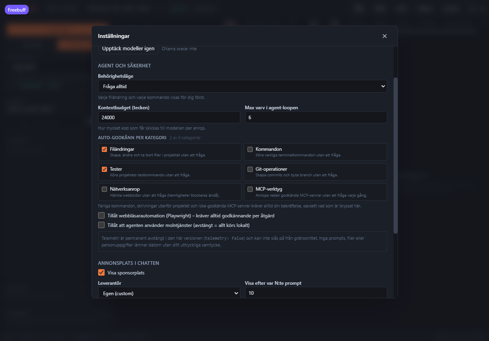

# Behörigheter och auto-godkännande

Freevobe frågar innan agenten ändrar något. Två rattar styr det: **behörighetsläget** (en helhet)
och **auto-godkännande per kategori** (finmaskigt). Kategorierna kan bara _lätta_ på reglerna –
aldrig stänga av säkerhetsspärrarna.

## Behörighetsläge

| Läge        | Filändringar | Kommandon/tester | Git      | Läsa kod |
| ----------- | ------------ | ---------------- | -------- | -------- |
| `ask`       | frågar       | frågar           | frågar   | tillåtet |
| `auto-edit` | tillåtet     | frågar           | frågar   | tillåtet |
| `auto-run`  | tillåtet     | tillåtet         | tillåtet | tillåtet |
| `full-auto` | tillåtet     | tillåtet\*       | tillåtet | tillåtet |

\* Farliga kommandon och skrivningar utanför projektet stoppas ändå.

Läget sätts i vänsterpanelen eller i Inställningar, och sparas per projekt.

## Auto-godkännande per kategori

Med kategorier kan du t.ex. låta agenten skriva och testa fritt medan varje terminalkommando
fortfarande frågar. Inställningarna ligger under **Inställningar → Agent och säkerhet →
Auto-godkänn per kategori** (och i kommandopaletten, `Ctrl/Cmd+K`), och gäller hela appen.

| Kategori     | Omfattar                                                  | Standard |
| ------------ | --------------------------------------------------------- | -------- |
| `file_write` | `write_file`, `edit_file`, `create_file`, `delete_file`   | av       |
| `command`    | `run_terminal_command`                                    | av       |
| `test`       | `run_tests` – projektets testkommando                     | av       |
| `git`        | `git_commit`, `git_branch`                                | av       |
| `network`    | `web_fetch` (hemligheter blockeras fortfarande)           | av       |
| `mcp`        | Verktyg från MCP-servrar som du redan godkänt i sessionen | av       |



När en kategori är på och policyn annars skulle ha frågat _mjukt_ körs anropet direkt, med
anledningen `Auto-godkänt av dig: kategorin "<kategori>"` i körningen. Behörighetsläget rörs inte:
`ask` + `file_write` på betyder "fråga om allt utom filändringar". Vänsterpanelen visar en rad
chips (`Auto: Filändringar, Tester`) så att du alltid ser vad som är påslaget.

## Det som aldrig auto-godkänns

Följande kräver alltid ett personligt ja, oavsett läge och kategori:

- **Farliga kommandon** – `rm -rf /`, `sudo`, diskformatering, `git push --force`, historikomskrivning,
  globala installationer, portexponering och hemligheter som skickas ut. Vissa blockeras helt.
- **Skrivningar utanför projektet** – sökvägskontrollen gäller alla lägen.
- **Webbläsarautomation** – `browser_*` (kategorin `browser` går inte att slå på).
- **MCP-servrar du inte godkänt** – fail closed tills du godkänt servern.
- **Verktyg med `alwaysRequiresApproval`** – t.ex. frågor till dig via `ask_user`.

Kategorierna `browser` och `other` finns i typen men saknar kryssruta, just för att de aldrig ska
kunna auto-godkännas.

## API

```bash
# Läs nuvarande inställningar
curl -s -H "x-freevobe-token: <token>" http://127.0.0.1:4319/api/settings

# Slå på auto-godkännande för filändringar och tester
curl -s -X PATCH -H "x-freevobe-token: <token>" \
  -H 'content-type: application/json' \
  -d '{"autoApprove":{"file_write":true,"test":true}}' \
  http://127.0.0.1:4319/api/settings
```

Svaret är alltid hela `AppSettings`, och `autoApprove` slås ihop med defaultvärdena – kategorier du
inte skickar behåller sitt tidigare värde (och blir `false` om de aldrig satts).

```json
{
  "permissionMode": "ask",
  "autoApprove": {
    "file_write": true,
    "command": false,
    "test": true,
    "git": false,
    "network": false,
    "mcp": false,
    "browser": false,
    "other": false
  }
}
```

## Testat

- `packages/agent-core/src/security/security.test.ts` – kategorier, hårda block, hemligheter och
  att bara den valda kategorin påverkas.
- `packages/agent-core/src/store/store.test.ts` – att inställningen slås ihop med defaultvärdena.
- `packages/agent-server/src/server.test.ts` – en hel körning i läget `ask` skriver filen **utan**
  att något godkännande skickas när `file_write` är på.
- `apps/desktop/src/components/AutoApproveSettings.test.tsx` – rutorna, beskrivningarna och chipsen.
- `e2e/auto-approve.ui.spec.ts` – i riktig webbläsare: inget godkännandekort med kategorin på, och
  kortet tillbaka så fort den slås av.
