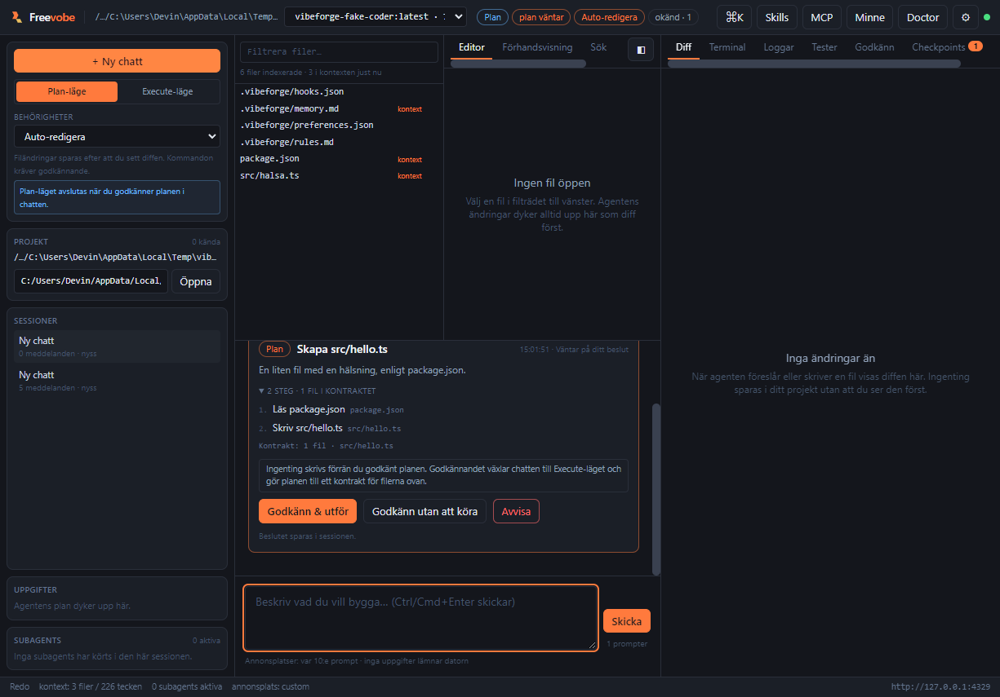
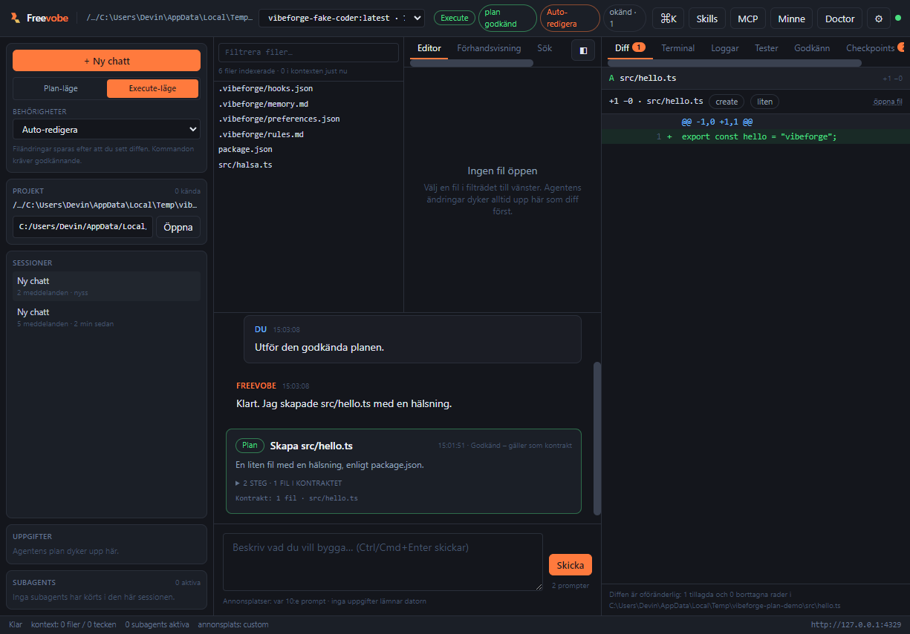

# Plan/Act – planen som kontrakt

Freevobe kan arbeta i två lägen per chatt:

- **Plan** – agenten läser kod och lägger fram en plan. Inga filer ändras och inga kommandon körs.
- **Execute** – agenten får skriva. Om en plan är godkänd gäller den som **kontrakt** för vad som
  får ändras.

Planen är alltså inte en text bland andra: den sparas i databasen, visas som ett kort i chatten och
kräver ditt ja innan något skrivs.

## Flödet

```
du: "Lägg till ett test för diff-motorn"        (Plan-läge)
  → agenten läser den relevanta koden
  → tool_call propose_plan { title, steps, files }
  → planen visas i chatten: steg, filer, "Väntar på ditt beslut"
  → körningen avslutas med reason "plan-ready" – inget skrevs
du: [Godkänn & utför]
  → planen blir "approved" och sessionen växlar till Execute
  → agenten kör med planen i systemprompten
  → filer utanför planen kräver ett personligt ja
```

### I gränssnittet

- **Plan/Execute-reglaget** i vänsterpanelen (och `Ctrl/Cmd+K` → _Plan-läge_) byter läge för
  chatten. Läget sparas på sessionen, så en plan-chatt kan ligga kvar i Plan medan en annan kör.
- **Plan-kortet** i chatten visar rubrik, sammanfattning, numrerade steg och vilka filer kontraktet
  omfattar. Knapparna är _Godkänn & utför_, _Godkänn utan att köra_ och _Avvisa_.
- **Statuschip** i toppraden: `plan väntar` när ett beslut ligger och `plan godkänd` när kontraktet
  gäller.
- Kommandopaletten har _Godkänn planen och utför den_ och _Avvisa planen_.



När planen är godkänd blir kortet grönt, toppraden visar `plan godkänd` och chatten står i
Execute-läget:



## Vad Plan-läget stoppar

Plan-läget är hårdare än alla behörighetslägen: varje verktyg som inte är `safe` nekas av loopen med
felet `policy_blocked` och ett meddelande till modellen om att beskriva ändringen i text i stället.
Det gäller även `full-auto`. Kvar att göra i Plan-läget är att läsa filer, söka i projektet, läsa
repo map – och att lägga fram en plan.

## Kontraktet i Execute-läget

När en plan är godkänd skickas den in i systemprompten under rubriken _Godkänd plan (kontrakt)_ med
stegen och filerna. Utöver det prövar loopen varje filändring mot planens filista:

| Situation                                     | Resultat                                        |
| --------------------------------------------- | ----------------------------------------------- |
| Filen står i planen                           | Vanliga behörighetsregler gäller                |
| Filen ligger under en katalog planen pekar ut | Vanliga behörighetsregler gäller                |
| Filen står **inte** i planen                  | Kräver ett personligt ja, oavsett läge/kategori |
| Planen namnger inga filer                     | Inga filvägar begränsas; stegen styr arbetet    |

Ett nej i godkännandekortet betyder att filen inte skrivs; agenten får `approval_rejected` och kan
lägga fram en ny plan. Bara filändringar kontrolleras – att läsa filer eller köra tester är alltid
förenligt med en plan.

En ny godkänd plan **ersätter** den gamla: sessionen har alltid exakt ett gällande kontrakt. Den
gamla planen blir `superseded` och syns kvar i historiken.

## Planstatus

| Status       | Betyder                               |
| ------------ | ------------------------------------- |
| `proposed`   | Väntar på användarens beslut          |
| `approved`   | Kontraktet som styr körningarna       |
| `rejected`   | Avvisad – agenten får inte utföra den |
| `superseded` | Ersatt av en nyare godkänd plan       |

## API

```bash
# Planer i en session (nyast först)
curl -s -H "x-freevobe-token: <token>" \
  http://127.0.0.1:4319/api/sessions/<sessionId>/plans

# En enskild plan
curl -s -H "x-freevobe-token: <token>" http://127.0.0.1:4319/api/plans/<planId>

# Godkänn (växlar sessionen till Execute) eller avvisa
curl -s -X POST -H "x-freevobe-token: <token>" -H 'content-type: application/json' \
  -d '{"decision":"approved"}' \
  http://127.0.0.1:4319/api/plans/<planId>/decision
```

En plan skapas av agenten via verktyget `propose_plan` under en körning – det finns ingen endpoint
för att skriva in en plan för hand, eftersom planen alltid hör till en körning och en session.

Verktyget tar `title`, `summary`, `steps` (rubrik + valfria filer per steg) och `files`. `files` är
kontraktet; stegens filer är information om vad steget rör (en fil som bara läses ska inte ge
skrivrätt). Om `files` saknas härleds kontraktet från stegen. Steg som skickas som rena strängar
fungerar också, och dubbletter/sökvägar normaliseras (`\` → `/`, `./` och inledande `/` tas bort).
Saknas rubrik eller steg får modellen ett fel tillbaka och kan rätta sig.

## Händelser

| Händelse        | Betyder                                           |
| --------------- | ------------------------------------------------- |
| `plan_proposed` | En plan väntar på beslut (`plan` i payloaden)     |
| `plan_decided`  | Användaren godkände/avvisade (`status`)           |
| `run_finished`  | `reason: "plan-ready"` när Plan-körningen är klar |

## Testat

- `packages/agent-core/src/agent/plan.test.ts` – parsning, normalisering, kontraktsgrind och
  prompttexten.
- `packages/agent-core/src/agent/loop.test.ts` – Plan-läget lägger fram planen och avslutar utan att
  skriva; en godkänd plan stoppar en fil utanför kontraktet även i `full-auto`, medan filen i planen
  skrivs utan fråga.
- `packages/agent-core/src/store/store.test.ts` – planen sparas, godkännandet blir kontrakt och en ny
  plan ersätter den gamla.
- `packages/agent-server/src/plans.test.ts` – hela flödet över HTTP, inklusive att godkännandet
  växlar sessionen till Execute och att kontraktet finns i systemprompten.
- `apps/desktop/src/components/chat/PlanCard.test.tsx` – kortet, godkännande med och utan körning,
  avvisning.
- `e2e/plan-mode.ui.spec.ts` – i riktig webbläsare: planen visas, inget skrivs, godkännandet startar
  körningen och filen skrivs.

## Begränsningar

- Kontraktet gäller **filvägar**, inte innehåll: agenten kan fortfarande ändra fel saker i en fil som
  står i planen. Diffen och checkpointen är skyddet där.
- Bara filändringar grindas. Ett kommando som rör filer utanför planen fångas av behörighetsläget
  och de farliga kommando-reglerna, inte av planen.
- Planen är per session, inte per projekt. Att byta chatt betyder att byta kontrakt.
- En plan måste läggas fram av modellen. Om modellen inte klarar tool calling kan den inte använda
  `propose_plan`, och då fungerar Plan-läget bara som ett läs-läge.
