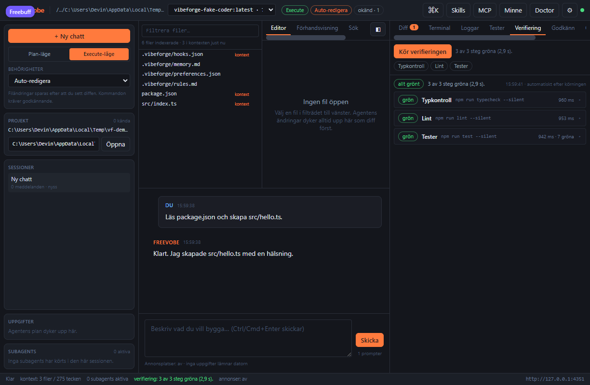
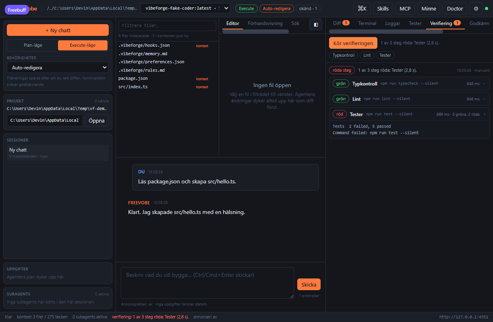

# Verifieringsmotorn

En agent som säger "klart" är inte samma sak som kod som fungerar. Verifieringsmotorn kör
**projektets egna kontroller** – typkontroll, lint, tester och bygge – och visar en rapport per steg
i stället för att låta modellen gissa. Inget hittas på: bara kommandon som faktiskt finns i
projektet körs, och varje steg redovisas med kommando, exit-kod, tid och utdata.

## Stegen

| Steg        | `kind`      | Hittas i (Node)                                 | Övriga källor                                  |
| ----------- | ----------- | ----------------------------------------------- | ---------------------------------------------- |
| Typkontroll | `typecheck` | `typecheck`, `type-check`, `tsc`, `check-types` | `mypy.ini` (Python)                            |
| Lint        | `lint`      | `lint`, `eslint`                                | `ruff.toml` (Python), `cargo clippy`, `go vet` |
| Tester      | `test`      | `test`, `test:unit`, `vitest`, `jest`           | `pytest`, `cargo test`, `go test`              |
| Bygge       | `build`     | `build`, `compile`                              | `cargo build`, `go build`                      |

Första träffen vinner, och pakethanteraren läses ur `packageManager` i `package.json`
(`npm run <skript> --silent`, `pnpm`/`yarn`/`bun run <skript>`). Ordningen är alltid typfel först
och bygget sist – det är billigast att få veta om koden ens kompilerar.

Saknar projektet skript hittas inga steg, och då körs ingenting. Panelen skriver ut varför i stället
för att visa en grön rapport utan innehåll.

## Automatiskt efter en körning

När en agentkörning avslutas normalt **och** minst en fil ändrades körs `typecheck`, `lint` och
`test` automatiskt. Bygget hoppas över – det är för tungt att köra varje gång – men agenten och du
kan köra det på begäran.

```text
run_finished (reason: final) + filer ändrade + verifyAfterRun
  → status: testing ("Verifierar projektet")
  → verification_started  (vilka steg som ska köras)
  → verification_check    (ett per avslutat steg, medan resten kör)
  → verification          (hela rapporten)
  → run_finished          (först därefter)
```

Rapporten skickas **innan** `run_finished`, så gränssnittet hinner visa den medan körningen
fortfarande lyssnar. Den sparas dessutom i databasen, så panelen visar senaste resultatet även
efter en omstart.

En röd kontroll avbryter inte körningen och gör den inte "misslyckad" – den är ett svar till
användaren, inte ett fel. Går själva verifieringen sönder (t.ex. att projektet stängts) skickas
`error` med koden `verification_failed` i stället.

Slå av och på beteendet i **Inställningar → Verifiera automatiskt efter en körning som ändrat
filer**, eller via API:t:

```bash
curl -s -X PATCH -H "x-freevobe-token: $(cat ~/.freevobe/token)" \
  -H 'content-type: application/json' -d '{"verifyAfterRun": false}' \
  http://127.0.0.1:4319/api/settings
```

## Manuellt

Tre vägar till samma motor:

1. **Panelen** – högerpanelen → **Verifiering** → _Kör verifieringen_. Knappen är avstängd medan
   en körning pågår, och panelen visar stegen som hittades redan innan du trycker.
2. **Kommandopaletten** (`Ctrl/Cmd+K`) – _Kör verifieringen_ och _Visa verifieringsrapporten_.
3. **API:t**:

```bash
# Vilka steg finns?
curl -s -H "x-freevobe-token: $(cat ~/.freevobe/token)" \
  "http://127.0.0.1:4319/api/projects/<projectId>/verification"

# Kör alla steg (eller bara några: {"kinds": ["typecheck", "test"]})
curl -s -X POST -H "x-freevobe-token: $(cat ~/.freevobe/token)" \
  -H 'content-type: application/json' -d '{}' \
  "http://127.0.0.1:4319/api/projects/<projectId>/verification"

# Historiken, nyast först
curl -s -H "x-freevobe-token: $(cat ~/.freevobe/token)" \
  "http://127.0.0.1:4319/api/projects/<projectId>/verifications?limit=5"
```

Agenten har samma motor som verktyget `run_verification` (`kinds` valfritt). Verktyget har
riskklassen `execute`, så det följer behörighetsläget och auto-godkännandet för kommandon – den
automatiska verifieringen efter en körning är däremot en del av körningen och kräver inget
godkännande, eftersom den bara kör projektets egna skript.

## Rapporten

```json
{
  "id": "verify_m8x1k2_9f3a",
  "projectId": "proj_…",
  "runId": "run_…",
  "trigger": "run",
  "status": "failed",
  "durationMs": 4210,
  "summary": "1 av 3 steg röda: Tester (4,2 s).",
  "checks": [
    {
      "id": "typecheck",
      "label": "Typkontroll",
      "kind": "typecheck",
      "command": "npm run typecheck --silent",
      "status": "passed",
      "exitCode": 0,
      "durationMs": 1830,
      "output": "…"
    }
  ]
}
```

- `status` är `passed`, `failed` eller `skipped` (inget steg hittades). Ett steg kan dessutom vara
  `timeout` eller `skipped` när körningen avbröts.
- `trigger` är `run` (automatiskt), `manual` (panelen eller API:t) eller `tool` (agenten).
- Utdata kapas till de **sista 8 000 tecknen** per steg – det är där felet brukar stå.
- Varje steg har **180 sekunder** på sig. Tidsgränsen är per steg, inte för hela rapporten.
- Körningen stannar inte vid första felet: en rapport med alla problem är mer användbar än bara
  det första.
- Teststeg får `passed`/`failed` räknat ur utdata (vitest, jest, pytest och `go test` tolkas).

Sammanfattningen skrivs på svenska och är den rad som syns i statusraden längst ner
(_"verifiering: 3 av 3 steg gröna (2,1 s)."_) och i rapportens huvud.

## Var det sparas

Rapporterna ligger i `verifications`-tabellen (migrering 4) med stegen som JSON. Frågan går alltid
mot `project_id`, så flera öppna projekt delar databas utan att blandas – samma princip som för
checkpoints. `list` returnerar de senaste 20 som standard.

## Panelen



Överst: knappen, senaste sammanfattningen och stegen som hittades. Under: antingen pågående steg
(medan de körs) eller rapporten med en rad per steg. Röda och överhoppade steg är utfällda från
början så att felet syns direkt; gröna steg fäller du ut själv för att läsa utdata. Varje rad visar
status, etikett, kommando, tid och – för teststeg – antal gröna och röda tester.

Är ett steg rött blir statusraden röd, rapporten säger _röda steg_ och felets utdata ligger redan
framme:



## Testat

- `packages/agent-core/src/verification/detect.test.ts` – skriptnamn, pakethanterare, Python, Rust,
  Go, ordning och att inget hittas på.
- `packages/agent-core/src/verification/engine.test.ts` – grön röd blandning, tidsgräns, avbrott,
  trunkerad utdata, testräkning och sammanfattningens svenska.
- `packages/agent-core/src/tools/verify.test.ts` – verktyget: godkännande, `kinds`, rapport och
  felväg när projektet saknar steg.
- `packages/agent-server/src/verification.test.ts` – HTTP + SSE: automatisk verifiering efter en
  körning som ändrat filer, ingen verifiering när inget ändrats, `verifyAfterRun: false`, manuell
  körning och historiken.
- `apps/desktop/src/components/panels/VerificationPane.test.tsx` – panelen: steg, pågående körning,
  rapport, tomt läge och knappen som kör mot API:t.
- `e2e/verification.ui.spec.ts` – en riktig webbläsare: agenten ändrar en fil, den automatiska
  verifieringen kör tre steg, statusraden och panelen visar _3 av 3 steg gröna_, rapporten säger
  _allt grönt_ och _automatiskt efter körningen_, och sidan kastar inga fel.

## Begränsningar

- Bara det öppnade projektets rot genomsöks. Ett monorepo med egna skript i varje paket får köra
  dem manuellt (eller via `kinds` och ett eget `custom`-steg i framtiden).
- Stegen är de som hittas i `package.json`, `pyproject.toml`, `ruff.toml`/`mypy.ini`, `Cargo.toml`
  och `go.mod`. Ett projekt utan sådana filer får ingen verifiering – inget gissas.
- Den automatiska körningen tar den tid projekttesterna tar. För långsamma sviter: stäng av
  automatiken och kör panelen när du vill.
- Rapporten visar utdata som text; den tolkar inte enskilda testnamn.
